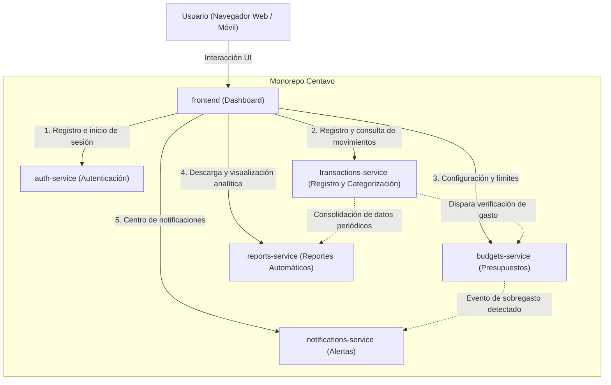

# Centavo 🪙

**Centavo** es una aplicación de finanzas personales diseñada para uso individual. Permite registrar gastos e ingresos, definir presupuestos mensuales por categoría, recibir alertas automáticas cuando se detecte riesgo o sobregasto, y consultar reportes periódicos de salud financiera.

---

## 🏛️ Arquitectura del Sistema

La solución adopta una arquitectura basada en **microservicios independientes** alojados en un **monorepo**, facilitando el desarrollo desacoplado, la escalabilidad y el mantenimiento individual de cada dominio.



---

## 📦 Componentes y Responsabilidades

| Componente | Carpeta | Propósito y Responsabilidades |
| :--- | :--- | :--- |
| **Frontend** | `/frontend` | **Panel de control (Dashboard):** Interfaz de usuario interactiva para visualizar balance general, capturar transacciones de forma rápida, administrar presupuestos visuales, consultar alertas y ver gráficos de gastos. |
| **Auth Service** | `/auth-service` | **Autenticación y Seguridad:** Manejo de usuarios, hashing de contraseñas, emisión y verificación de tokens (JWT / sesiones) y gestión de credenciales para proteger los demás microservicios. |
| **Transactions Service** | `/transactions-service` | **Gestión de Gastos e Ingresos:** Registro, edición, eliminación y categorización automática o manual de movimientos financieros (alimentación, transporte, servicios, etc.). |
| **Budgets Service** | `/budgets-service` | **Control de Presupuestos:** Definición de techos y límites de gasto por categoría y periodicidad (mensual/semanal), monitoreo del progreso de consumo y detección de desviaciones. |
| **Notifications Service** | `/notifications-service` | **Motor de Alertas:** Generación y despacho de alertas de sobregasto, avisos de acercamiento al límite presupuestario (ej. 80%, 100%) y recordatorios por canal preferido (en app, email o push). |
| **Reports Service** | `/reports-service` | **Analítica y Reportes Automáticos:** Generación periódica (mensual/anual) de estados financieros, resúmenes de tendencias de gasto, comparativas históricas y exportaciones en formatos como PDF/CSV. |

---

## 📂 Estructura del Monorepo

```text
CentavoApp/
├── README.md
├── frontend/                  # Interfaz de usuario (SPA / Dashboard)
├── auth-service/              # Microservicio de identidad y acceso
├── transactions-service/      # Microservicio de transacciones y categorías
├── budgets-service/           # Microservicio de presupuestos y topes
├── notifications-service/     # Microservicio de despacho de alertas
└── reports-service/           # Microservicio de consolidación y reportes
```

---

## 🔄 Flujo de Trabajo Principal

1. **Ingreso:** El usuario inicia sesión a través del `frontend`, validado por `auth-service`.
2. **Registro de Gasto:** El usuario registra un nuevo gasto en el `frontend`. La petición llega a `transactions-service`.
3. **Control Presupuestario:** `transactions-service` comunica el nuevo movimiento a `budgets-service` para computar el saldo consumido en la categoría.
4. **Alerta de Sobregasto:** Si el consumo alcanza o excede el umbral configurado, `budgets-service` emite una señal a `notifications-service`, el cual envía la alerta al usuario.
5. **Reporte Periódico:** En segundo plano o a petición, `reports-service` procesa el historial acumulado en `transactions-service` para presentar métricas y balances consolidados en el `frontend`.
